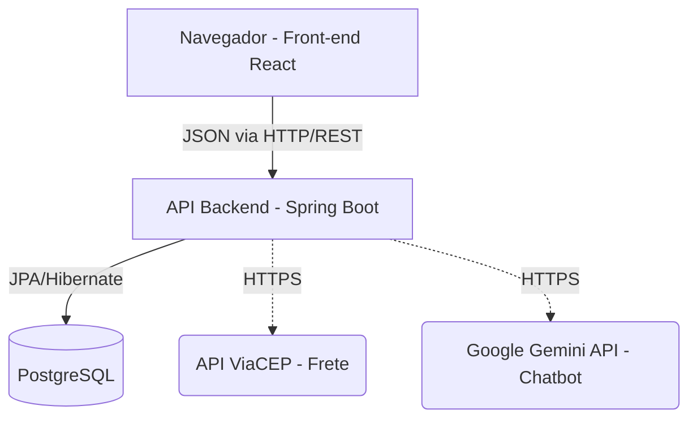
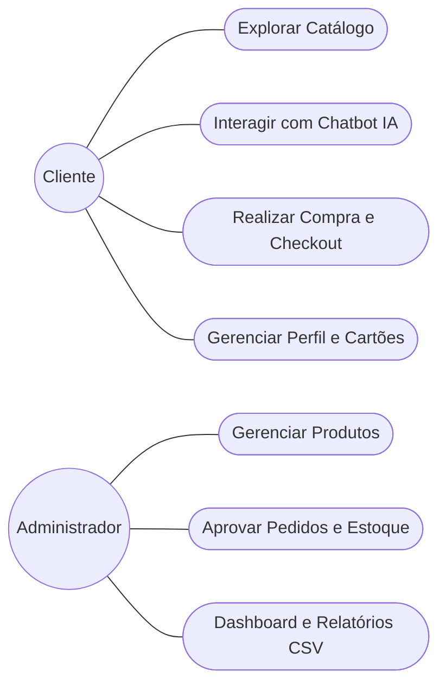
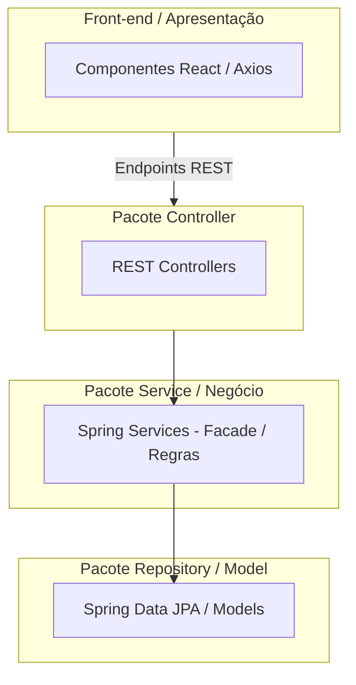
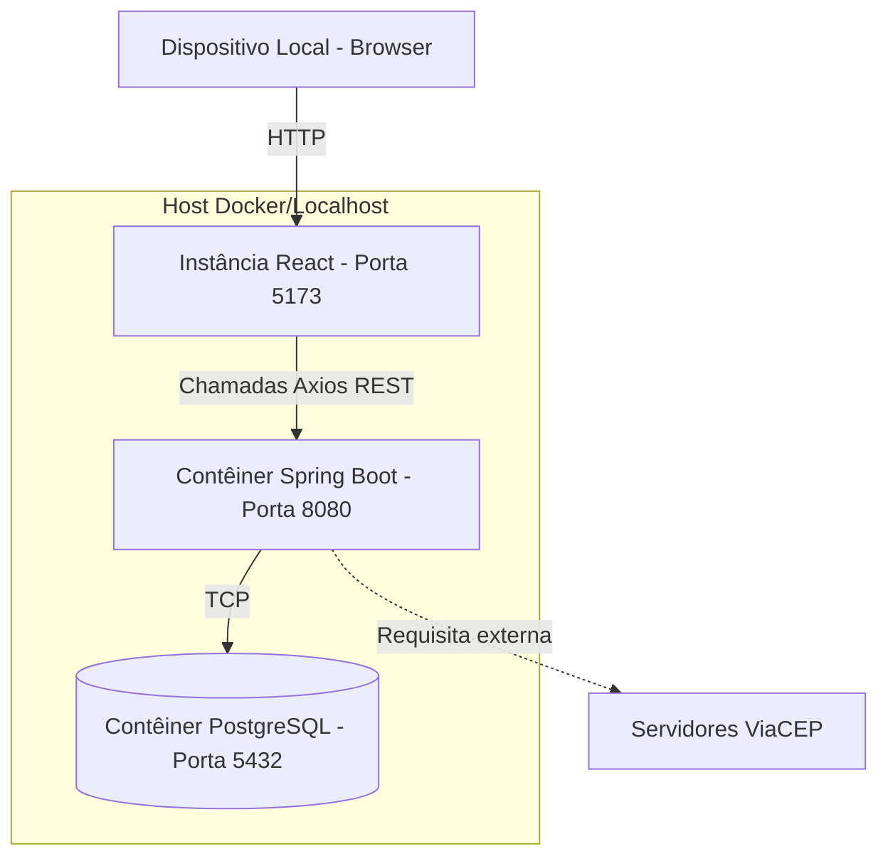
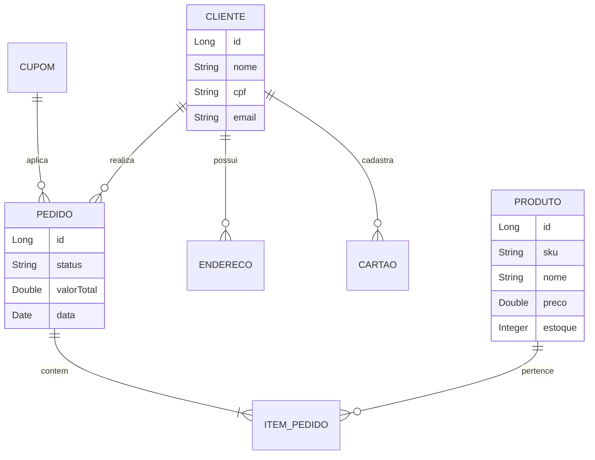

# Documento de Visão do Projeto - Caramelo Cerâmicas
*(Copie o conteúdo abaixo e cole/substitua as seções correspondentes no seu arquivo DVP.docx. Os diagramas podem ser visualizados clicando neles, tire um print ou salve a imagem para colar no Word).*

---

## 1. Capa, Histórico de Versões e Página de Assinaturas
**Nome do Projeto:** Caramelo Cerâmicas
**Autor:** Matheus Schalch (e grupo, se houver)
**Cliente:** FATEC / Professor responsável
**Versão:** 1.0 - Elaboração inicial do DVP.

## 2. Objetivo
Este documento formaliza o início do projeto "Caramelo Cerâmicas", apresentando a visão geral e arquitetônica da solução que será desenvolvida ao longo da disciplina. O objetivo é alinhar as expectativas sobre as tecnologias, a estrutura de pastas e as funcionalidades do sistema, que propõe o desenvolvimento de um e-commerce B2C focado na venda de peças utilitárias de cerâmica artesanal para mesa posta.

## 3. Escopo
Este documento trata do escopo preliminar e da visão de arquitetura do sistema a ser desenvolvido. O documento não lista regras de validação detalhadas tela a tela, pois o detalhamento minucioso de fluxos, restrições e regras de negócio será documentado nas etapas subsequentes, como no Documento de Requisitos e modelagens específicas.

## 4. Referências
- Documentação inicial da disciplina e orientações do professor.
- Planilha de Estimativas de Prazos e Cronograma (Caramelo Cerâmicas).
- Apresentação inicial do Protótipo Funcional e Levantamento de Requisitos.

## 5. Necessidades de Negócio
A ausência de uma plataforma digital focada exclusivamente no nicho de cerâmicas artesanais dificulta o acesso dos clientes a produtos exclusivos e cria barreiras para a expansão das vendas por parte dos artesãos e estúdios. O sistema é necessário para digitalizar o catálogo físico, automatizar as vendas, processar os pagamentos online (com cupons) e gerenciar o estoque de forma integrada. Sem esse sistema, o estúdio perderia alcance de mercado, faria o controle de pedidos manualmente e os clientes teriam uma experiência de compra engessada.

## 6. Objetivo do Projeto
Desenvolver uma plataforma de e-commerce (solução web) capaz de:
- Gerenciar o cadastro e exposição de produtos de cerâmica (peças, dimensões, estoque);
- Processar o fluxo completo de compras online (carrinho, checkout, cálculo de frete automático via API, e pagamento);
- Controlar as operações de gestão: andamento de pedidos, trocas e baixa automática de estoque;
- Oferecer uma IA Generativa (Chatbot) que recomende peças com base no estilo de compra;
- Fornecer um Dashboard com gráficos de vendas e exportação CSV para análise do administrador.
**Benefício esperado:** Redução do trabalho manual de controle de vendas, melhoria significativa na experiência de atendimento do cliente e maior controle gerencial.

## 7. Declaração Preliminar de Escopo
**7.1 Descrição**
O Caramelo Cerâmicas é uma plataforma web B2C dedicada à venda de peças de cerâmica. O cliente final interage com o catálogo e um chatbot inteligente para compras, enquanto o estúdio acessa uma área restrita (Painel Admin) para gerenciar o andamento dos pedidos, estoque das peças e visualizar o relatório financeiro e de vendas mensais em gráficos de linhas.

**7.2 Produtos a serem entregues**
- Sistema Web (Frontend em React e Backend em Spring Boot) implementado;
- Banco de Dados PostgreSQL configurado localmente;
- Documentação de Visão do Projeto (DVP) e Documento de Requisitos;
- Testes E2E executados no Cypress.

**7.3 Requisitos (visão geral)**
*7.3.1 Requisitos Funcionais*
- O sistema deve ser capaz de manter um cadastro único de peças de cerâmica e de clientes (com múltiplos endereços e cartões).
- O sistema deve ser capaz de gerenciar compras no carrinho, calculando o frete via CEP e aplicando cupons.
- O sistema deve ser capaz de realizar baixa no estoque, registrar pedidos e permitir fluxo de trocas.
- O sistema deve ser capaz de plotar gráficos gerenciais das vendas filtrando por período e exportar em CSV.
- O sistema deve ser capaz de fornecer recomendações por chat através de integração com IA.

*7.3.2 Requisitos Não Funcionais*
- O sistema deve ser construído na linguagem Java 21, utilizando Spring Boot 3.x para a API.
- O sistema deve utilizar React e Bootstrap 5 no front-end.
- O sistema deve usar o banco de dados PostgreSQL.
- A arquitetura da solução obedecerá o padrão MVC e os patterns Facade e Strategy.

*7.3.3 Cronograma de Marcos Sumariado / Regras de Negócio*
**Regras de Negócio Iniciais:** 
- O estoque não pode receber peças com quantidade zero.
- A baixa de estoque só é efetuada quando a compra assumir o status EM PROCESSAMENTO.
- Descontos que fujam da margem de lucro parametrizada exigirão validação/restrição no negócio.

## 8. Premissas
- O projeto será orientado aos prazos e diretrizes da disciplina na FATEC.
- A API do Google Gemini Studio AI estará disponível de forma gratuita para a implementação do Chatbot.
- A aplicação rodará em ambiente local, não necessitando de hospedagem em nuvem para homologação nesta fase da disciplina.

## 9. Influência das Partes Interessadas
- **Professor / Orientador:** Interessado na aderência da arquitetura, qualidade do código, testes com Cypress e uso correto das ferramentas e prazos da disciplina.
- **Administrador do Estúdio (Simulado):** Interessado na assertividade do Dashboard para tomada de decisões e na automatização dos controles de entrega/estoque.
- **Cliente Final (Simulado):** Interessado em uma plataforma intuitiva, onde encontrar e pagar por uma cerâmica artesanal e receber recomendações do chatbot seja simples e rápido.

## 10. Representação Arquitetural
A arquitetura do Caramelo Cerâmicas utiliza o modelo Cliente-Servidor baseado em APIs. O Front-end será uma aplicação SPA (Single Page Application) em React responsável pelas telas, enquanto o Back-end funcionará como uma API RESTful provida pelo Spring Boot.

*10.1 Restrições Arquiteturais*
- Utilização obrigatória da linguagem Java (JDK 21) no back-end.
- Utilização do framework Spring (Spring Web, Spring Data JPA) para a API.
- Servidor web embutido Tomcat (padrão do Spring Boot).

*10.2 Objetivos e Restrições Arquiteturais*
- O backend precisará comunicar-se com sistemas externos de forma assíncrona/síncrona (API ViaCEP e Gemini), exigindo tratamento correto contra instabilidades externas.

## 11. Visão de Use Case
*(Abaixo está o diagrama geral representando as funções do Cliente e Administrador)*

*11.2 Descrição dos Casos de Uso Arquiteturalmente Significativos*
- **Realizar Compra e Checkout:** Ocorre quando o cliente preenche o endereço e escolhe os cupons/cartões. O sistema aciona o backend que consulta o ViaCEP, aplica regras de negócio financeiras, processa a transação e enfileira o pedido para o status inicial.
- **Interagir com Chatbot IA:** O cliente faz perguntas sobre peças. O backend recebe o texto, anexa informações de contexto (prompts do catálogo) e dispara a requisição para a API do Google Gemini, devolvendo a resposta processada para o frontend.

## 12. Visão de Lógica
A solução backend no Spring Boot está organizada internamente seguindo as responsabilidades de negócio e persistência.

*12.1 Camada de Apresentação (React):* Contém os componentes JSX, hooks e serviços Axios que se conectam aos endpoints da aplicação, além de validações visuais.
*12.2 Camada de Controle e Negócio:* Os Controllers recebem o DTO e direcionam para o pacote de `Services`, onde moram as validações do negócio e cálculos financeiros/integrações IA.
*12.3 Camada de Persistência:* O pacote Repository contém as interfaces que estendem `JpaRepository`, utilizando o Hibernate por baixo dos panos para gravar no PostgreSQL.

## 13. Visão de Implantação
Para este projeto na disciplina, toda a estrutura rodará sob um único ambiente (localhost), porém com a separação lógica e conteinerizada.

## 14. Visão de Implementação
A estrutura de arquivos do código refletirá exatamente a Visão de Lógica. O Backend terá pastas baseadas em domínio e padrão MVC (`/src/main/java/.../controllers`, `/services`, `/repositories`, `/models`), enquanto o frontend ficará isolado em uma pasta ou repositório à parte.

## 15. Visão de Dados
O sistema utiliza o PostgreSQL. O Spring Data JPA traduzirá as Classes de Modelo (Lógico) para Entidades Físicas (Tabelas) via Migrations (Flyway).

## 16. Tamanho e Performance
Considerando que a aplicação se destina a um e-commerce artesanal em fase acadêmica/inicial, não haverá altíssimo volume simultâneo. O dimensionamento considerará picos de até algumas dezenas de usuários fazendo checkout simultaneamente. O tempo de resposta alvo das consultas de catálogo deve estar na faixa de milissegundos (< 1 seg).

## 17. Qualidade
A aplicação preza fortemente pela **consistência**, garantindo que não ocorram vendas duplas para a mesma peça artesanal, e pela **usabilidade**, garantindo que a tela flutuante do chatbot e o fluxo de pagamento com cupons sejam fluidos no frontend.

## 18. Cronograma Macro
- **1º Entrega:** Levantamento, Kanban e elaboração do Documento de Visão de Projeto (DVP).
- **2º Entrega:** Modelagem do Banco, Diagramas, Criação do Repositório e Configuração CI/CD.
- **3º Entrega:** Implementação dos CRUDs, Telas Administrativas e API.
- **4º Entrega:** Fluxo E-commerce completo (Carrinho, Checkout), Chatbot e Testes Cypress.
- **5º Entrega:** Apresentação Final da Solução Integrada.

## 19. Referências Finais
- Especificações do UML.
- Documentação do Spring Framework e JPA/Hibernate.
- Guias de Integração Axios e APIs REST.
- Documentação de Integração da API ViaCEP e Google Gemini.
